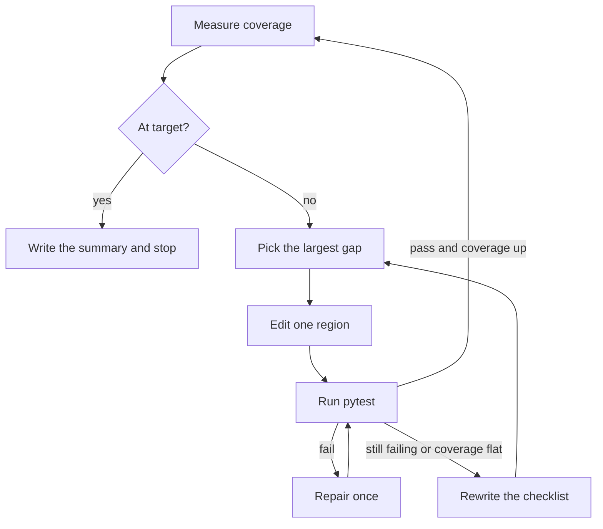

# Self-improving coverage agent

**It commits a change only when pytest passes and coverage goes up.**

Point it at a Python repository. Each round covers one uncovered function. If the round fails, those edits are reverted and the checklist for the next round is rewritten.

```text
uv run coverage-agent run --demo
```

That command uses no API key and no network. The bundled fixture starts at 75% because `sub` has no test. A scripted model writes the missing test. Stdout is the coverage change, the branch, and one line per round:

```text
75.0% -> 100.0% on branch coverage/raise-to-100 (target hit)
round 1: covered sub in fixture_app/calc.py (+25.0)
```

Progress goes to stderr:

```text
Measuring coverage (round 0)
Coverage 75.0%
Planning fixture_app/calc.py sub
Editing tests/test_calc.py
Tests passed. Coverage 100.0% (+25.0)
Measuring coverage (round 1)
Coverage 100.0%
```

The starting code is [examples/fixture_app](examples/fixture_app). `tests/test_calc.py` calls `add`. `sub` is the gap:

```python
def sub(left: int, right: int) -> int:
    return left - right
```

A normal run calls Groq, Together.ai, Gemini, or a local Ollama model. Groq is the default. The demo model is scripted so the command can run anywhere.

## Run it on a repository

The repository has to be a git checkout with a clean worktree, and the tests that are already there have to pass.

```text
uv sync --extra dev
copy .env.example .env
uv run coverage-agent run C:\path\to\repo --target 80
```

On macOS or Linux, use `cp .env.example .env`. Put `GROQ_API_KEY` in `.env`.

```text
uv run coverage-agent run . --target 80 --provider gemini --max-rounds 5
uv run coverage-agent run . --target 80 --provider ollama
```

Python 3.11 or newer. Without uv: `python -m venv .venv`, activate it, then `pip install -e ".[dev]"`.

The run creates a branch named `coverage/raise-to-80`. Read that branch before you merge it. The checklist at `.coverage-agent/strategy.md` and the round log at `.coverage-agent/run.md` stay untracked. The next run in the same checkout starts from the checklist.

Stdout is the summary line. A missing key, a dirty worktree, a failing existing suite, or a tree with no Python files is named on stderr and the process exits 1. If the loop finishes under the target, it still exits 0 and the summary says `target not hit`.

## Loop



coverage.py ranks files by missing lines. tree-sitter names the function that owns the first missing line, and the planner picks that function. The editor writes at most three Python files. The usual change is one test file. If pytest fails, one repair runs and pytest runs again.

When tests pass and coverage rises, that round is committed. When coverage does not rise, the worktree returns to the last good commit and the strategist rewrites the checklist. The next round reads the new checklist.

The loop stops when coverage is at or above `--target`, when two rounds in a row fail to raise it, or after `--max-rounds` (default 5).

The editor has no shell. The only commands the loop runs are `pytest` and `coverage json`.

## What a round may change

- A test for the uncovered function. Tests that already pass stay in the file.
- Production code, only when the planner says a value is hard-coded and a test cannot pass it in. The edit adds an argument and keeps the old value as the default.
- The checklist at `<repo>/.coverage-agent/strategy.md`. The package ships [a default checklist](src/coverage_agent/prompts/default_strategy.md) for the first run. The agent's own Python is left as it was installed.

The checklist asks the model to assert a return value. That is an instruction to the model, not a proof that the new test is meaningful.

## Providers

| Provider | Environment | Default model | Notes |
| --- | --- | --- | --- |
| `groq` | `GROQ_API_KEY` | `openai/gpt-oss-120b` | Default. Free tier is about 30 requests per minute and 200,000 tokens per day. Llama 3.1 and 3.3 chat ids are enterprise-only on Groq. |
| `together` | `TOGETHER_API_KEY` | `openai/gpt-oss-120b` | Signup credits, not an ongoing free tier. |
| `gemini` | `GEMINI_API_KEY` | `gemini-3.8-flash` | Create the key in [Google AI Studio](https://aistudio.google.com/apikey). |
| `ollama` | none | `qwen2.5:7b` | Local. `ollama pull qwen2.5:7b`, then `--provider ollama`. |

`LLM_PROVIDER` is the fallback when you omit `--provider`. `PLANNER_MODEL`, `EDITOR_MODEL`, `REPAIR_MODEL`, and `STRATEGIST_MODEL` override one role.

Keys: [Groq](https://console.groq.com/keys), [Together](https://api.together.ai/settings/api-keys), [Gemini](https://aistudio.google.com/apikey).

## Development

```text
uv sync --extra dev
uv run ruff check .
uv run ruff format --check .
uv run pytest
```

The default suite does not call a model. `uv run pytest -m live` sends one planner call to Groq and spends quota. CI runs Ruff and the default suite on Python 3.12 and 3.14.

## License

[MIT](LICENSE)
